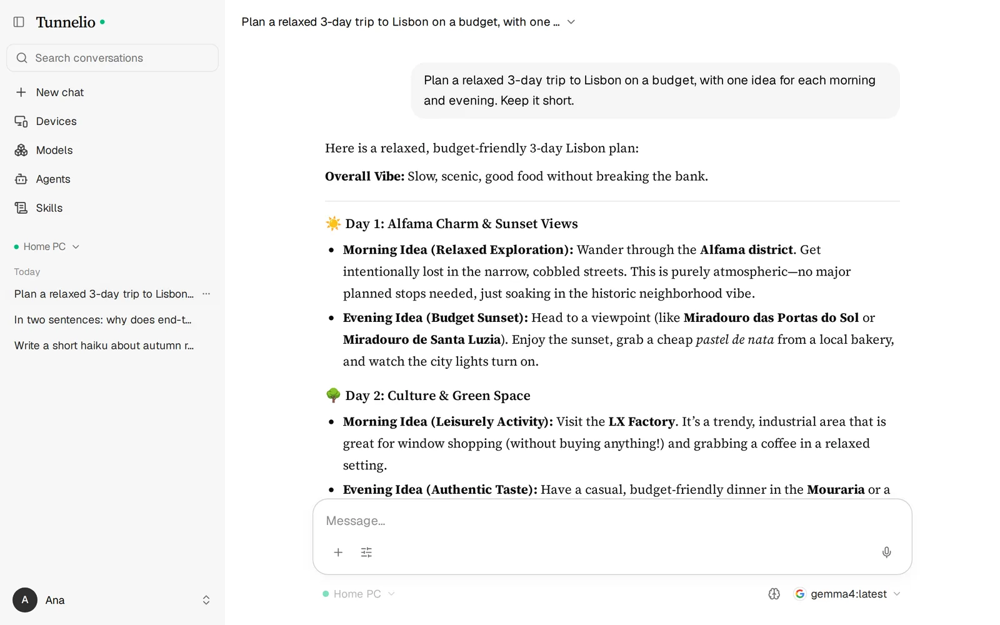
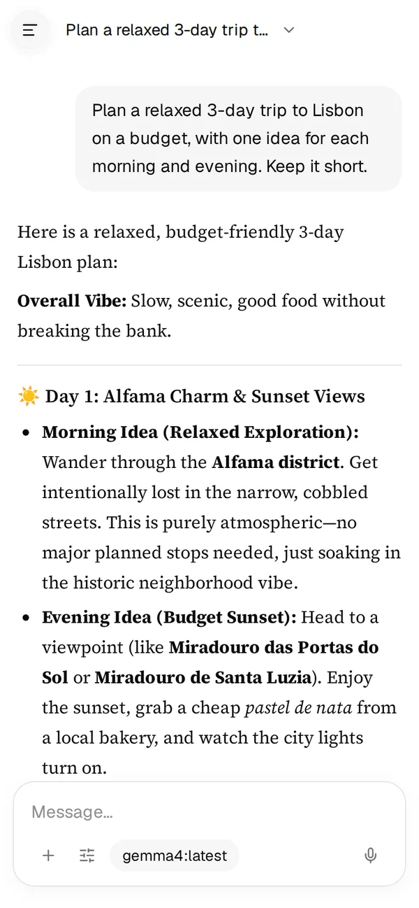
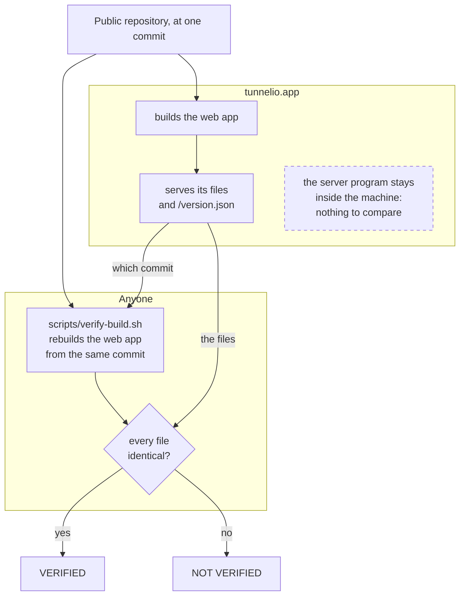

# Tunnelio

**Use the Ollama models on your own computer from any browser — your phone, a laptop, a locked-down
work PC — with nothing to install on that device, no ports to open, and a relay server that cannot
read a single byte of your conversations.**

<p align="center">
  <picture>
    <source media="(prefers-color-scheme: dark)" srcset="docs/assets/screenshot-desktop-dark.webp">
    
  </picture>
  &nbsp;
  <picture>
    <source media="(prefers-color-scheme: dark)" srcset="docs/assets/screenshot-phone-dark.webp">
    
  </picture>
</p>

Tunnelio has three parts:

- **The computer app** (`tray/`, Go) runs next to Ollama, in the system tray.
- **The web app** (`web/`, React) runs in any browser.
- **The relay** (`server/`, Django) passes encrypted messages between the two and cannot open them.

You can use the hosted service at [tunnelio.app](https://tunnelio.app) or run the whole thing
yourself. The code is free software under the [AGPL-3.0](#license).

## What you can do

- **Chat** with any model installed on your computer, with answers streamed as they are written.
  Models that reason show their thinking. Each model keeps its own settings. Vision models take
  images, and you can attach documents (PDF, Word, spreadsheets, text), which are read in the
  browser. Dictation uses the browser's own speech service (Chrome, for one, sends the audio to
  Google). Anonymous chats leave nothing on the computer.
- **Manage models**: see what is installed and loaded, and download from the Ollama library with
  one click, with the size of each download shown first. Delete what you no longer need.
- **Agents and skills**: an agent is a model with its own instructions, settings and skills; a skill
  is a reusable set of instructions. Agents can be **chained**: each one hands its answer to the
  next, the last one replies, and the earlier answers stay folded above the reply.
- **Several computers and browsers**: pair a computer once with a 12-symbol code (or a QR code).
  Every browser you sign in to gets the pairings and your preferences, sealed with your password.
- **Account**: the name the app calls you, your computers, active sessions with sign-out, password
  change and two-step sign-in.

## How it works

```mermaid
sequenceDiagram
    actor You
    participant B as Browser (web app)
    participant R as Relay (server)
    participant T as Computer app
    participant O as Ollama

    Note over B,T: Once per computer: pairing with the 12-symbol code shown by the computer app.<br/>Both ends get the same key; the relay passes the pairing along and never learns it.<br/>Your other browsers receive it sealed with your password.

    You->>B: types a message
    Note over B: encrypts it
    B->>R: sealed message
    Note over R: sees its size, the time and which computer,<br/>never the content
    R->>T: the same sealed message
    Note over T: decrypts it and accepts only<br/>the allowed request types
    T->>O: /api/chat on 127.0.0.1
    O-->>T: the reply, word by word
    Note over T: keeps the conversation<br/>on this computer
    T-->>R: sealed reply
    R-->>B: sealed reply
    B-->>You: decrypts and shows it
```

1. **The computer app** keeps an *outgoing* WebSocket to the relay, so nothing on your network is
   exposed. It talks only to your local Ollama. It accepts only a closed list of request types, each
   mapped to one fixed Ollama endpoint or to its own history file. It keeps your conversations,
   agents and skills in that SQLite file on the computer, readable only by your system account.
2. **The relay** authenticates accounts, registers devices and forwards opaque frames between the
   browser and the computer. It never sees plaintext and never routes on content.
3. **The web app** does everything else in the browser: sign-in, pairing, chat, models, history,
   agents and skills. There is one password, from which the browser derives the sign-in key and the
   key that seals your pairings. Sign-up and password reset use a code sent by e-mail, and two-step
   sign-in is optional.

Under the hood: SPAKE2 pairing (RFC 9382), X25519 session keys and AES-256-GCM on every message. The
protocol is specified in [`docs/SPEC.md`](docs/SPEC.md) and pinned by test vectors that both
implementations, Go and TypeScript, must reproduce byte for byte.

## Security and privacy

- **What the relay knows**: your e-mail address, your devices and when they connect, the sizes
  and times of messages and, while you are connected, your IP address (for the attempt limits; it
  is not stored). Whatever sits in front of the relay (a proxy or tunnel that ends TLS) sees the
  same, and only ciphertext. It never sees your prompts, your answers, your models or your files.
  The complete list, and the threats considered, are in [`docs/SPEC.md` §1](docs/SPEC.md#1-overview-and-threat-model).
- **Where your conversations live**: only on the computer that runs Ollama, in the computer app's
  SQLite file. Tunnelio does not encrypt that file itself. **Turn on your system's disk
  encryption** (BitLocker on Windows, FileVault on macOS, LUKS on Linux) so a lost or stolen
  computer does not give them away.
- **You can check the web app**: the files tunnelio.app serves can be compared, one by one, with a
  rebuild of this repository (see [Verifying what tunnelio.app runs](#verifying-what-tunnelioapp-runs)).
- **Your password protects everything sealed with it**: use a long one. The app refuses passwords
  that are easy to guess.
- **Found a vulnerability?** Report it privately, as described in [`SECURITY.md`](SECURITY.md).

## Getting started

You need [Ollama](https://ollama.com/download) and at least one model on the computer that will run
them.

1. **Install the computer app** from the [latest release](https://github.com/ThiagoBzMd/tunnelio/releases/latest):
   `Tunnelio-macos.dmg` (Apple silicon and Intel), `Tunnelio-windows.zip` (Windows 10 and 11) or
   `Tunnelio-ubuntu.deb` (Ubuntu and Debian), with ARM builds for Windows and Linux. The installers
   are not signed yet: macOS asks you to allow the app in System Settings → Privacy & Security, and
   Windows may warn about an unknown publisher.
2. **Create an account** at [app.tunnelio.app](https://app.tunnelio.app) (or on your own server, see
   below).
3. **Pair the computer**: in the computer app's menu, choose **Pair a device…**. A page opens with
   a 12-symbol code and a QR code. In the web app, choose **Add a device** and type the code, or
   scan the QR code with your phone. The secret part of the code (8 of the 12 symbols) never
   reaches the server.
4. **Chat**: pick the computer and a model.

The computer app does not update itself: its menu tells you when a newer release is out, with a
link to download it.

## Self-hosting

For people who prefer their own relay. Everything below runs on infrastructure you control;
tunnelio.app is not involved. It assumes some comfort with Docker and a terminal.

1. **Run the server**: one container with the relay, the API, the web app and SQLite.

   ```bash
   cd deploy
   printf 'SECRET_KEY=%s\nALLOWED_HOSTS=<server>.<your-tailnet>.ts.net\n' \
     "$(python3 -c 'import secrets; print(secrets.token_urlsafe(50))')" > .env   # keep this file
   docker build -f ../server/Dockerfile -t ghcr.io/thiagobzmd/tunnelio-server:latest ..   # or pull a released image
   docker compose up -d                  # listens on 127.0.0.1:8080 only
   ```

2. **Put HTTPS in front.** Browsers only run Tunnelio's encryption on `https://`, or on
   `http://localhost` of the same computer. Over plain `http://` on any other address the app says
   so and stops. The simplest way is Tailscale on your own account: enable HTTPS certificates in
   your tailnet, run `tailscale serve --bg 8080` on the server, and open
   `https://<server>.<your-tailnet>.ts.net` from devices in your tailnet (`<server>` is that
   machine's name in the tailnet, the same as in `ALLOWED_HOSTS`; phones need the Tailscale app). Your own domain behind a reverse proxy works too. If the proxy puts the visitor's address in
   a header of its own, name it in `CLIENT_IP_HEADER` (for example `X-Real-IP`).
3. **Create your account**, then close sign-up: add `REGISTRATION_ENABLED=false` to `.env` and run
   `docker compose up -d` again (a restart alone does not reload `.env`).
4. **Point each computer at your server**: in the computer app's menu, Settings… → Server address.
   Quit and reopen the app, then pair it again. Installers from the releases point to tunnelio.app
   by default.

These are optional:

- `EMAIL_URL` (SMTP) sends sign-up codes and makes "forgot password" work. Without it a lost password
  cannot be reset, but nothing on your computers is lost: create a new account and pair again.
- `BOT_CHECK_*` adds a bot check (a captcha widget of your choice) on sign-in, sign-up and password
  reset.
- `DATABASE_URL` switches to Postgres.
- `REDIS_URL` allows more than one worker.

Every variable is in [`server/.env.example`](server/.env.example). The production layout of
tunnelio.app (images built on the server from this repository) is described in
[`deploy/README.md`](deploy/README.md).

## Verifying what tunnelio.app runs

The web app is the part that sees your password and encrypts your conversations, so it is the part
worth checking. Every build publishes the public commit it was made from at `/version.json` (also
shown in Settings → General → Build), and the build is reproducible:



```bash
scripts/verify-build.sh                       # https://app.tunnelio.app, or pass another address
```

The script reads that commit, rebuilds the web app from it with the same container recipe that
production uses, and compares every file byte for byte with what the address serves. It runs from a
clone of this repository and needs Docker.

- **What it proves:** that the files the address served to the script, when it ran, are exactly
  the ones built from the public code. A server could still serve other files to other visitors or
  at other times, so this detects a change rather than prevents one; running it now and then, from
  different places, is what makes it useful.
- **What it cannot prove:** what the server runs behind it. `/api/version` says which commit the
  server was built from, but that cannot be checked from outside.

The server never sees your conversations or your password either way.

## Development

Prerequisites: Go (the version in `tray/go.mod` or newer), Python 3.12, Node 20 (`.nvmrc`), Docker,
and Ollama for the tests that talk to a real model. The Make targets and the scripts also expect:

- a virtual environment in `server/.venv` with the development packages
  (`python3 -m venv server/.venv && server/.venv/bin/pip install -r server/requirements/dev.txt`);
- [golangci-lint](https://golangci-lint.run) v2, for `make lint` and `scripts/check.sh`;
- Playwright's Chromium, for `scripts/e2e.sh` (`cd web && npx playwright install chromium`).

```bash
make help                    # every target
make test                    # unit tests: server (pytest), tray (go test), web (vitest)
scripts/check.sh             # what CI runs: vectors, server, web, tray and interop
scripts/interop.sh           # a real server, a headless tray and the Node client (+ local Ollama when present)
scripts/e2e.sh               # Playwright on phone and desktop sizes, with screenshots
```

Building the computer app: `cd tray && go build ./cmd/tunnelio` (on macOS with `CGO_ENABLED=1`);
details and the release process are in [`tray/README.md`](tray/README.md).

### Repository layout

```
tray/      the computer app (Go)            — module github.com/ThiagoBzMd/tunnelio/tray
server/    relay, accounts and admin (Django + Channels) — one port (8080)
web/       the web app (React + TypeScript) — served by nginx in production, by the server image when self-hosted
docs/      SPEC.md (the protocol and data-model contract), the test vectors and the README's images
deploy/    docker-compose files (self-hosting; the production layout of tunnelio.app)
brand/     the logo masters and the pipeline that generates every icon
scripts/   development, test and verification scripts
.github/   build and release workflows, issue and pull-request templates
```

## Contributing

Bug reports, ideas and pull requests are welcome. Read [`CONTRIBUTING.md`](CONTRIBUTING.md) first:
it explains the design rules a change must keep and the terms of contributions. Everyone taking part
follows the [Code of Conduct](CODE_OF_CONDUCT.md).

## License

Copyright © 2026 Thiago Bezerra Matias.

Tunnelio is free software: you can redistribute it and modify it under the terms of the
**GNU Affero General Public License, version 3 only** ([`LICENSE`](LICENSE)). In short:

- you may use, study, change and share it, commercially too;
- if you distribute it, or let others use a modified version over a network, you must make the
  source of your version available under the same licence;
- it comes with no warranty.

[`LEGAL.md`](LEGAL.md) explains the licence in plain words, and gathers everything else legal:
- **The name "Tunnelio" and the logo**: the licence grants no trademark rights to them. A modified
  version that you distribute, or offer as a service to others, needs its own name and logo
  ([`TRADEMARKS.md`](TRADEMARKS.md)).
- **Third-party components** keep their own licences ([`THIRD_PARTY_NOTICES.md`](THIRD_PARTY_NOTICES.md)).

## Acknowledgements

Tunnelio stands on [Ollama](https://ollama.com), and on the libraries, fonts and icons listed in
[`THIRD_PARTY_NOTICES.md`](THIRD_PARTY_NOTICES.md). Thank you to everyone who builds them.
